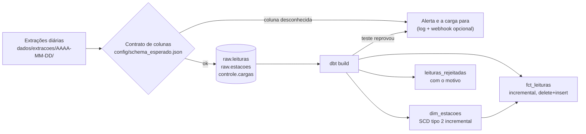

# Cargas incrementais idempotentes com dbt e DuckDB

> Projeto pessoal que recria, com dados sintéticos, técnicas que uso no trabalho. Não contém código nem dados de nenhuma empresa.

Um pipeline que recebe um arquivo por dia de uma rede de estações meteorológicas, com leituras atrasadas, duplicadas, corrigidas e inválidas, e entrega uma tabela sem duplicata e um cadastro com histórico (SCD tipo 2). Rodar duas vezes não muda nada. Rodar em partes dá o mesmo que rodar tudo de uma vez.

[](https://github.com/Ryan-abreu-dados/Projetos/actions/workflows/cargas.yml)

## Problema

Carga incremental parece simples: "pega o que é novo e acrescenta". Na prática, o que chega todo dia tem problema:

- leitura **atrasada**, medida há três dias e entregue hoje;
- leitura **retransmitida**, idêntica, no mesmo arquivo ou no do dia seguinte;
- leitura **corrigida**, reenviada com outro valor (vale a última);
- leitura **inválida**, de sensor com defeito (999,9 °C, chuva negativa);
- **cadastro que muda**: estação renomeada, altitude corrigida, estação em manutenção;
- **coluna nova** no arquivo, sem aviso.

O pipeline precisa aguentar tudo isso e poder rodar de novo a qualquer momento, depois de uma queda ou por engano, sem duplicar nada.

## Dados

Sintéticos, gerados por [`pipeline/gerar_extracoes.py`](pipeline/gerar_extracoes.py) com semente fixa: 200 estações, leituras de hora em hora, 30 dias de extrações (uma pasta por dia com `estacoes.csv` e `leituras.csv`). As probabilidades ficam em constantes no topo do arquivo: 5% atrasadas, 3% retransmitidas, 1% corrigidas, 0,5% inválidas.

Volume de uma execução: **148.139 linhas recebidas** para **142.631 leituras únicas**.

O gerador também grava `dados/gabarito.json` com o que o pipeline deveria produzir, calculado em Python e independente do SQL. Os testes comparam o resultado com esse gabarito.

## Arquitetura



Três decisões que seguram o resto:

1. **Watermark pela data de chegada, não pela hora da medição.** A raw guarda `_extracao`, a data em que o arquivo chegou, e a fato processa só extrações novas. Uma leitura atrasada tem `medido_em` antigo mas chega numa extração nova, então entra. Com watermark por `medido_em`, ela ficaria para trás sem erro nenhum.
2. **Upsert pela chave natural.** A fato usa `delete+insert` por `(estacao_id, medido_em)`: retransmissão e correção substituem a linha antiga.
3. **SCD tipo 2 calculado por dia de extração.** A cada execução, junto o cadastro que chegou com a versão vigente de cada estação e comparo dia a dia pelo hash dos atributos. Não usei `dbt snapshot` porque ele só vê o estado no momento em que roda: carregar 30 dias de uma vez guardaria só o último dia.

Na raw, cada extração entra numa transação, junto com o registro em `controle.cargas`. Se o processo cair no meio, a próxima execução recomeça daquela extração.

## Como rodar

Este projeto fica na pasta `cargas-incrementais-dbt` do repositório [Projetos](https://github.com/Ryan-abreu-dados/Projetos). Todos os comandos abaixo rodam de dentro dela:

```bash
git clone https://github.com/Ryan-abreu-dados/Projetos.git
cd Projetos/cargas-incrementais-dbt
```

Não precisa de banco nem de conta: DuckDB é um arquivo.

```bash
docker compose up --build      # gera 30 dias, roda duas vezes, confere e grava resultados/resultados.md
```

Ou direto na sua máquina (Python 3.12):

```bash
pip install -r requirements.txt
python -m pipeline gerar                          # 30 dias, 200 estações
python -m pipeline rodar                          # carrega o que é novo e roda dbt build
python -m pipeline rodar                          # de novo: nada novo, nada muda
python -m pipeline medir                          # idempotência, gabarito e tempos
python -m pytest -v                               # 12 testes (7 rodam o pipeline inteiro)
```

Para ver a carga parar por causa de coluna nova:

```bash
python -m pipeline gerar --drift-a-partir 20      # a coluna umidade_pct aparece no dia 20
python -m pipeline rodar                          # carrega os dias 1 a 19 e para no 20, com alerta
```

Para receber os alertas num webhook (Slack ou Discord), defina `ALERTA_WEBHOOK_URL`. No GitHub, vira um secret do repositório. O workflow `cargas-incrementais-agendado` roda tudo toda segunda-feira.

## Resultados medidos

Rodada completa em [`resultados/resultados.md`](resultados/resultados.md), num notebook i5-8265U com 16 GB de RAM e Windows 11.

| Medida | Valor |
|---|---|
| Linhas recebidas | 148.139 |
| Leituras únicas recebidas | 142.631 |
| Linhas na fato | 141.884 (igual ao gabarito) |
| Rejeitadas pela regra de validade | 747 (igual ao gabarito) |
| Versões de estação (SCD tipo 2) | 243, com 32 estações com mais de uma versão (igual ao gabarito) |
| Linhas que um watermark pela hora da medição teria ignorado | 9.989 |
| Rodar duas vezes dá o mesmo conteúdo | sim |
| Carga em duas partes = carga completa | sim |
| `--full-refresh` = incremental | sim |

"Mesmo conteúdo" quer dizer contagem e md5 do conteúdo ordenado de cada tabela final, comparados entre as execuções.

As 9.989 linhas vêm de uma simulação em SQL sobre os mesmos dados: para cada extração, contei as linhas medidas antes da maior medição já vista nas extrações anteriores. São atrasadas, retransmissões do dia seguinte e correções. Um pipeline diário filtrando por `medido_em` não carregaria nenhuma delas.

| Tempo | Total | Só a carga na raw |
|---|---|---|
| Carga completa (30 dias) | 14,7 s | 3,7 s |
| Incremental de 1 dia | 8,7 s | 0,2 s |
| Repetida sem extração nova | 8,5 s | |

O total é dominado pela partida do dbt, uns 8 segundos fixos por execução nesta máquina.

Os testes ([`tests/`](tests)) cobrem: resultado igual ao gabarito, rodar de novo sem mudança, carga em três partes igual à completa, `--full-refresh` igual ao incremental, queda simulada no meio de uma extração, coluna nova parando a carga e alertando, e um teste de dados do dbt reprovando de verdade (leitura de uma estação que não existe no cadastro).

## O que deu errado e o que eu faria diferente

Registro completo em [`NOTAS-DE-BUILD.md`](NOTAS-DE-BUILD.md).

- **Tudo passou de primeira, e isso me deixou desconfiado.** Fiz um teste de mutação: troquei o watermark da fato para `medido_em` e rodei os testes. Só o teste de carga em partes reprovou. A carga completa de uma vez passa mesmo com o filtro errado, porque tudo cabe num lote só. Esse tipo de bug só aparece com execuções incrementais, e é por isso que o teste existe.
- **Bug no gerador, pego antes de rodar.** Uma correção podia cair no mesmo dia que uma retransmissão da mesma leitura, com valores diferentes. O "último envio" ficaria ambíguo e o resultado mudaria entre execuções. Agora a correção sempre chega depois de qualquer outro envio.
- **O tempo do incremental não impressiona.** Com 150 mil linhas, a partida do dbt pesa mais que os dados. A carga na raw caiu de 3,7 s para 0,2 s, mas o total foi de 14,7 s para 8,7 s.
- **Faria diferente:** guardar o watermark de cada modelo numa tabela de controle em vez de calcular `max(_extracao)` da própria tabela; tratar estação removida do cadastro; e testar com volume maior para o incremental fazer diferença no tempo.

---

## English summary

An incremental pipeline (Python + DuckDB + dbt) for daily weather-station extracts with late, duplicated, corrected and invalid readings plus slowly changing station metadata. Key choices: watermark on arrival date rather than event time, `delete+insert` on the natural key, and an incremental SCD type 2 computed per extract day (instead of `dbt snapshot`, which only sees the state at run time). Measured: 148,139 rows received → 141,884 fact rows, matching an independently computed answer key; running twice, loading in parts, and `--full-refresh` all produce identical content (row count + md5). On the same data, an event-time watermark would have skipped 9,989 rows. Schema drift stops the load and fires an alert; failing dbt tests fail the run. `docker compose up --build` runs everything.
