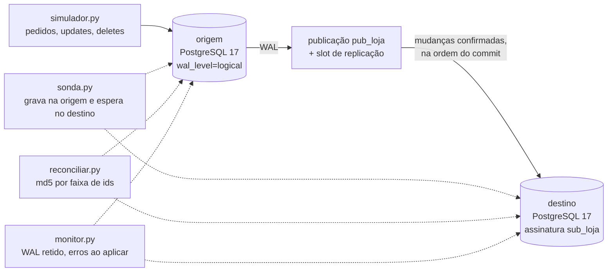

# Replicação incremental (CDC) entre dois PostgreSQL, com falhas e reconciliação

> Projeto pessoal que recria, com dados sintéticos, técnicas que uso no trabalho. Não contém código nem dados de nenhuma empresa.

Um banco transacional de loja virtual replica cada mudança para um banco analítico usando a replicação lógica nativa do PostgreSQL. Com a loja em movimento, o projeto mede o atraso, desliga o destino, derruba a conexão, cria conflitos de propósito e confere, linha a linha, se os dois lados têm o mesmo dado.

[](https://github.com/Ryan-abreu-dados/Projetos/actions/workflows/cdc.yml)

## Problema

Relatório pesado não deve rodar no banco que atende a loja. A saída comum é copiar os dados para outro banco. Copiar a tabela inteira toda noite fica caro e deixa o relatório um dia atrasado. CDC (*change data capture*) copia só o que mudou, quase na hora: cada INSERT, UPDATE e DELETE confirmado na origem é lido do log de transações (WAL) e aplicado no destino.

O difícil não é ligar a replicação. É saber o que acontece quando:

- o destino fica fora do ar enquanto a loja continua vendendo;
- a conexão cai;
- alguém escreve direto no destino;
- uma coluna nova aparece na origem;
- uma tabela nova é criada e ninguém a coloca na replicação.

Alguns desses casos travam a replicação com erro. Outros deixam tudo "verde" com o dado errado. Para esses existe a reconciliação.

## Dados

Sintéticos, gerados por [`cdc/preparar.py`](cdc/preparar.py) com Faker (nomes e cidades em português) e semente fixa:

| Tabela | Linhas na carga inicial |
|---|---|
| clientes | 20.000 |
| produtos | 1.000 |
| pedidos | 100.000 |
| itens_pedido | cerca de 250.000 |

Depois disso, [`cdc/simulador.py`](cdc/simulador.py) gera movimento contínuo: pedidos novos com itens, mudança de status, reajuste de preço, clientes novos e exclusão de pedidos cancelados (os itens saem em cascata).

## Arquitetura



- **Publicação** (na origem): a lista de tabelas que vão para o destino. Uso lista explícita, não `FOR ALL TABLES`, para tabela nova não entrar sem alguém decidir.
- **Assinatura** (no destino): conecta na origem, faz a cópia inicial e depois aplica as mudanças. Ela cria na origem um **slot**, que marca até onde o destino já leu. Enquanto o destino não confirma, a origem guarda o WAL.
- **Sonda**: uma linha gravada na origem e esperada no destino. Como o destino aplica as mudanças na ordem do commit, quando a sonda chega, tudo o que foi gravado antes também chegou. Uso isso para medir atraso e para saber se o destino alcançou a origem.

Escolhi a replicação lógica nativa e não Debezium + Kafka porque o destino aqui também é PostgreSQL. Debezium faria sentido com vários destinos diferentes ou para alimentar um data lake; aqui seriam três serviços a mais para o mesmo resultado.

## Como rodar

Este projeto fica na pasta `cdc-postgres-replicacao` do repositório [Projetos](https://github.com/Ryan-abreu-dados/Projetos). Todos os comandos abaixo rodam de dentro dela:

```bash
git clone https://github.com/Ryan-abreu-dados/Projetos.git
cd Projetos/cdc-postgres-replicacao
```

Precisa de Docker. Sem conta paga e sem segredo: a senha `postgres` só vale para os bancos locais.

```bash
docker compose up --build      # sobe os dois bancos e roda o roteiro completo → resultados/resultados.md
```

Os bancos ficam nas portas **5441** (origem) e **5442** (destino). Para usar os scripts a partir da sua máquina:

```bash
docker compose up -d --wait origem destino
pip install -r requirements.txt
python -m cdc.preparar                       # schema, dados, publicação, assinatura, cópia inicial
python -m cdc.simulador --segundos 60        # loja em movimento
python -m cdc.monitor                        # WAL retido, atraso, erros ao aplicar
python -m cdc.reconciliar                    # compara os dois lados (--corrigir para consertar)
python -m pytest -v                          # 11 testes
```

Com `make`: `make run`, `make test`, `make monitor`, `make reconciliar`.

## Resultados medidos

Rodada completa em [`resultados/resultados.md`](resultados/resultados.md). Medi num notebook i5-8265U com 16 GB de RAM e SSD, com dois PostgreSQL 17 rodando direto no Windows, na mesma máquina, com a configuração do `docker-compose.yml`.

| Medida | Valor |
|---|---|
| Carga inicial | 370.708 linhas em 4 tabelas |
| Cópia inicial para o destino | 2,6 s |
| Carga simulada na origem | 85 operações/s |
| Atraso da origem ao destino: mediana / p95 / p99 / máximo | 0,3 / 3,1 / 3,3 / 26,7 ms |
| Sondas que não chegaram em 10 s | 0 de 300 |
| Destino desligado por 30 s | 2.736 operações na origem nesse tempo |
| WAL retido no slot: antes → fim da pausa | 1,77 MB → 3,39 MB |
| Destino alcança a origem depois de religado | 0,72 s |
| Replicação volta depois de derrubar a conexão | 2,47 s |
| Divergências depois das falhas | 0 |
| Linhas alteradas direto no destino → achadas → depois de corrigir | 3 → 3 → 0 |

Como ler esses números:

- **A mediana de 0,3 ms está no limite da medição.** É o tempo de uma consulta ao destino: na maioria das vezes a primeira consulta depois do INSERT já achava a sonda. Origem e destino estão na mesma máquina; em rede o atraso seria maior.
- **A taxa ficou abaixo do alvo de 200 operações/s.** O simulador usa uma conexão só, e cada operação é um commit gravado em disco. Para mais carga, eu usaria várias conexões.
- **WAL retido é o custo do destino parado.** Nesta carga foram cerca de 1,6 MB em 30 s. Com o destino fora por horas, isso cresce até encher o disco da origem. O `max_slot_wal_keep_size=1GB` no compose limita o estrago: passado o limite, o slot é invalidado e o destino precisa de uma nova cópia inicial.

Os testes ([`tests/test_replicacao.py`](tests/test_replicacao.py)) cobrem a cópia inicial; INSERT, UPDATE e DELETE em cascata; destino parado acumulando WAL e alcançando depois; conexão derrubada voltando sozinha; e os casos que dão problema:

| Situação | O que acontece | Teste |
|---|---|---|
| Alguém altera ou apaga linha no destino | Nada. A replicação segue sem erro e o dado fica errado. Só a reconciliação acha. | `test_divergencia_silenciosa_e_achada_e_corrigida` |
| Linha com o mesmo id gravada no destino antes de chegar da origem | A replicação **trava** (chave duplicada) até alguém apagar a linha do destino. | `test_conflito_de_chave_trava_ate_alguem_resolver` |
| Coluna nova na origem | A replicação **trava** até a coluna existir no destino. DDL não replica. | `test_coluna_nova_na_origem_trava_ate_existir_no_destino` |
| Tabela nova fora da publicação | Nada. Sem erro e sem dado, até alguém incluir e rodar `REFRESH PUBLICATION`. | `test_tabela_fora_da_publicacao_nao_replica_ate_ser_incluida` |

A reconciliação ([`cdc/reconciliar.py`](cdc/reconciliar.py)) compara contagem e md5 por faixa de 10 mil ids. Só desce linha a linha nas faixas diferentes, e confere de novo depois de uma sonda para descartar o que ainda estava a caminho. `--corrigir` copia da origem as linhas que faltam ou divergem. Linha que só existe no destino é listada, nunca apagada sozinha. E ela se recusa a rodar com a replicação parada: copiar agora uma linha que ainda vai chegar causaria o conflito de chave da tabela acima.

## O que deu errado e o que eu faria diferente

Registro completo em [`NOTAS-DE-BUILD.md`](NOTAS-DE-BUILD.md).

- **Chave estrangeira no destino.** Para simular uma linha apagada no destino, tentei apagar um produto. A chave estrangeira barrou, porque há itens apontando para ele. Só que essas mesmas chaves não barram a replicação: o destino aplica as mudanças como réplica, sem disparar essas checagens. No destino, a integridade é responsabilidade da origem.
- **A reconciliação podia piorar as coisas.** Na primeira versão, `--corrigir` copiava qualquer linha faltando. Com a replicação parada, a linha faltando ainda ia chegar, e a cópia manual causaria conflito de chave quando ela chegasse. Coloquei a trava: sem sonda chegando, não reconcilia.
- **Erro de tipo no simulador, pego na revisão.** `round(preco * 1.05, 2)` com o fator vindo do Python como `float` vira `double precision`, e o PostgreSQL não tem `round(double, 2)`. Resolvi com `%s::numeric`.
- **Faria diferente:** medir com origem e destino em máquinas separadas; simular várias conexões; testar o slot sendo invalidado pelo `max_slot_wal_keep_size` e a recuperação com nova cópia inicial; e comparar com Debezium para ver o custo da peça a mais.

---

## English summary

Change data capture between two PostgreSQL 17 instances using native logical replication (publication, subscription, replication slot), driven by a synthetic online-store workload. Measured on one laptop: 370,708 rows copied initially in 2.6 s; end-to-end lag median 0.3 ms (at the probe's resolution), p99 3.3 ms; after 30 s with the subscriber disabled, it caught up in 0.72 s; after killing the replication connection, it recovered in 2.47 s. Tests cover the failure modes that break replication (duplicate key written on the subscriber, new column on the publisher) and the ones that stay silent (rows edited on the subscriber, table left out of the publication). A range-based md5 reconciliation found the 3 rows edited on the subscriber and fixed them. `docker compose up --build` runs the whole scenario.
