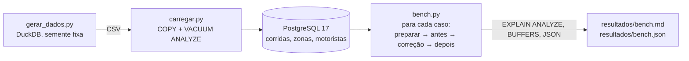

# Otimização de consultas no PostgreSQL com EXPLAIN ANALYZE

> Projeto pessoal que recria, com dados sintéticos, técnicas que uso no trabalho. Não contém código nem dados de nenhuma empresa.

Cinco consultas lentas de propósito numa base de 5 milhões de corridas de táxi sintéticas. Para cada uma: o plano de execução antes, o diagnóstico, a correção e o plano depois, com o tempo medido dos dois lados.

[](https://github.com/Ryan-abreu-dados/Projetos/actions/workflows/explain.yml)

## Problema

Consulta lenta quase nunca se resolve no chute. O caminho que sigo é sempre o mesmo: rodar `EXPLAIN (ANALYZE, BUFFERS)`, ler onde o tempo e as leituras se concentram, mudar uma coisa e medir de novo. Este repositório é esse caminho aplicado a cinco problemas comuns:

| # | Problema | Correção |
|---|---|---|
| 1 | Função na coluna do filtro (`date(iniciada_em) = ...`) | Índice + filtro por intervalo |
| 2 | Relatório que lê a tabela para cada linha achada no índice | Índice covering (`INCLUDE`) |
| 3 | Estatísticas defasadas depois de carga em massa | `ANALYZE` |
| 4 | `UPDATE` em massa deixando linhas mortas | `VACUUM` + autovacuum ajustado na tabela |
| 5 | Paginação com `OFFSET` alto | Paginação por chave (keyset) |

## Dados

Sintéticos, gerados por [`scripts/gerar_dados.py`](scripts/gerar_dados.py) com DuckDB, semente fixa:

- `corridas`: 5 milhões de linhas em 2025 (o caso 3 acrescenta mais 1 milhão em janeiro de 2026). Poucas zonas concentram muitas corridas, 70% delas em horário comercial, duração com cauda longa. As linhas ficam gravadas em ordem de horário, como numa base real.
- `zonas`: 260 linhas. `motoristas`: 20 mil linhas.

O CSV de corridas tem cerca de 400 MB e não vai para o repositório (`dados/` está no `.gitignore`).

## Arquitetura



Cada caso é uma pasta em [`sql/casos/`](sql/casos) com `consulta_antes.sql`, `correcao.sql`, `consulta_depois.sql` e, quando precisa, `preparar.sql` (monta o cenário) e `parametros.sql`. Os casos rodam em sequência no mesmo banco, então o índice criado no caso 1 está lá no caso 2, e assim por diante.

## Como rodar

Este projeto fica na pasta `postgres-explain-otimizacao` do repositório [Projetos](https://github.com/Ryan-abreu-dados/Projetos). Todos os comandos abaixo rodam de dentro dela:

```bash
git clone https://github.com/Ryan-abreu-dados/Projetos.git
cd Projetos/postgres-explain-otimizacao
```

Precisa de Docker. Sem conta paga e sem segredo: a senha `postgres` só vale para o banco local.

```bash
docker compose up --build        # gera 5 milhões de linhas, roda os 5 casos e grava resultados/bench.md
```

O PostgreSQL fica na porta **5433** do host, para não brigar com um PostgreSQL já instalado. Para rodar os testes ou o benchmark a partir da sua máquina:

```bash
docker compose up -d --wait db
pip install -r requirements.txt
python -m pytest -v                          # 100 mil linhas, confere os planos
python -m scripts.bench --linhas 5000000     # o mesmo que o compose roda
```

Com `make`: `make run`, `make test`, `make bench`.

## Resultados medidos

Notebook Intel Core i5-8265U (4 núcleos, 8 threads), 16 GB de RAM, SSD, Windows 11 e PostgreSQL 17 rodando direto na máquina, com a mesma configuração do `docker-compose.yml` (`shared_buffers=256MB`, `work_mem=16MB`, `jit=off`). Tempo é a mediana de 5 execuções com cache quente; a primeira é descartada. A tabela completa, com planos e tamanhos, está em [`resultados/bench.md`](resultados/bench.md).

| Caso | Antes | Depois | O que mudou no plano |
|---|---|---|---|
| 1. Função no filtro | 1,20 s | 3,9 ms | Seq Scan em 5 milhões de linhas → Index Scan em 13.785 |
| 2. Índice covering | 149,9 ms | 132,1 ms | Index Scan → Index Only Scan; blocos lidos de 6.450 para 2.097 |
| 3. Estatísticas defasadas | 4,89 s | 864 ms | Nested Loop → Hash Join; estimativa de 1 linha → 1.010.351 (real: 1.000.000) |
| 4. UPDATE em massa e VACUUM | 352,5 ms | 259,2 ms | Index Scan → Index Only Scan; 1.670.871 linhas mortas → 0 |
| 5. Paginação | 1,35 s | 0,04 ms | Linhas percorridas: 2.400.050 → 50 |

O que eu tiro de cada caso:

1. **Só o índice não basta.** Com o índice criado, `date(iniciada_em) = ...` continua lendo a tabela inteira (há um teste que prova isso). O índice custou 104,6 MB e 6,2 s para criar.
2. **Ler menos blocos nem sempre é ficar mais rápido.** O covering leu 3 vezes menos blocos, mas o tempo ficou dentro da variação. Como as corridas estão gravadas em ordem de horário, o Index Scan já lia páginas vizinhas. O custo real era agregar 424 mil linhas. E o índice novo ocupa 192 MB.
3. **O planejador decide com o que as estatísticas dizem.** Para um valor que não aparece nelas (`pix`), ele estima 1 linha e escolhe fazer uma busca no índice de motoristas para cada corrida. Foram 3 milhões de blocos lidos contra 63 mil depois do `ANALYZE`. Desliguei o autovacuum da tabela nesse caso para reproduzir a janela entre a carga e o autoanalyze.
4. **`VACUUM` limpa, mas não devolve espaço.** As linhas mortas zeraram e a tabela continuou com 629,4 MB. O espaço fica livre para os próximos `UPDATE`. Depois do `UPDATE` em massa o planejador abandonou o Index Only Scan, e o Index Scan leu 536.758 blocos para 423.876 linhas, porque as versões novas foram gravadas no fim da tabela.
5. **`OFFSET` lê e joga fora.** Para entregar 50 linhas no meio da tabela, o banco percorreu 2,4 milhões. Com keyset, lê 50 em qualquer página. Um teste confere que as duas consultas devolvem a mesma página.

Os testes ([`tests/test_planos.py`](tests/test_planos.py)) conferem o **plano**, não o tempo: tipo de nó, linhas lidas, estimativa contra o real, linhas mortas. Tempo varia de máquina para máquina e oscila muito no GitHub Actions.

## O que deu errado e o que eu faria diferente

O registro cru está em [`NOTAS-DE-BUILD.md`](NOTAS-DE-BUILD.md). O principal:

- **Esperei uma coisa no caso 4 e o planejador fez outra.** Eu esperava ver o Index Only Scan continuar no plano com muitos `Heap Fetches`. Ele trocou de índice. O teste agora aceita os dois sinais, porque os dois mostram o mesmo problema.
- **O covering do caso 2 quase não mudou o tempo.** Mantive o caso assim mesmo, porque o resultado honesto ensina mais do que um exemplo escolhido para dar certo.
- **A medição no notebook varia muito.** O "antes" do caso 3 foi de 3,56 s a 8,18 s entre execuções. Por isso o relatório mostra mediana e faixa, nunca uma execução só.
- **Índices sobrepostos.** No fim ficam três índices começando por `iniciada_em`, e os índices somam 877 MB contra 629 MB da tabela. Em produção eu juntaria os casos 1, 2 e 5 num índice só e mediria de novo.
- **Faria diferente:** medir também com cache frio (reiniciando o banco), e usar `pg_stat_statements` para descobrir as consultas lentas em vez de partir de uma lista pronta.

---

## English summary

Five deliberately slow PostgreSQL queries on 5 million synthetic taxi rides, each diagnosed with `EXPLAIN (ANALYZE, BUFFERS)`, fixed and measured again. Results on a laptop (median of 5 warm runs): function on the filtered column 1.20 s → 3.9 ms; stale statistics after a bulk load 4.89 s → 864 ms (row estimate 1 → 1,010,351); `OFFSET` pagination 1.35 s → 0.04 ms with keyset pagination. Two cases are reported as they came out: a covering index cut blocks read 3× but barely changed the time, and `VACUUM` cleared 1.67 million dead rows without shrinking the table. Tests assert plan shapes, not timings. Run everything with `docker compose up --build`.
